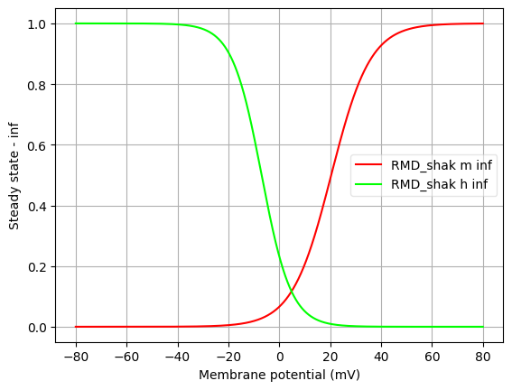
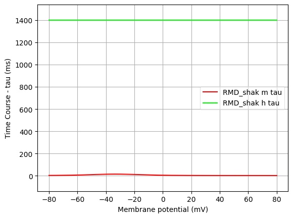

Channel information
===================

Channel information at: T = 6.3 degC, E_rev = -80.0 mV, [Ca2+] = 5e-05 mM

<h2>RMD_shak</h2>

Ion: <b>k</b> |
Conductance expression: <b>g = gmax * m * h </b> |
NeuroML2 file: <a href="../RMD_shak.channel.nml">RMD_shak.channel.nml</a>

Notes
RMD_shak channel from Nicoletti et al. 2019

