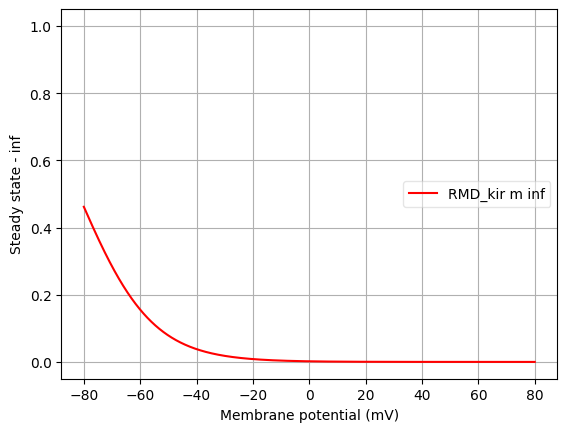
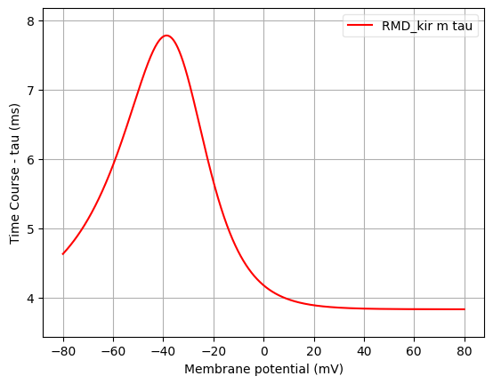
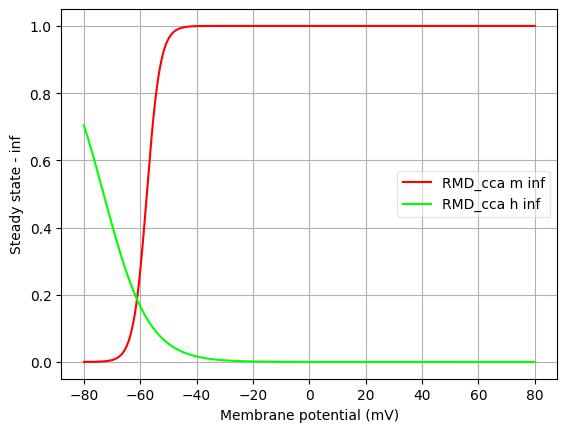
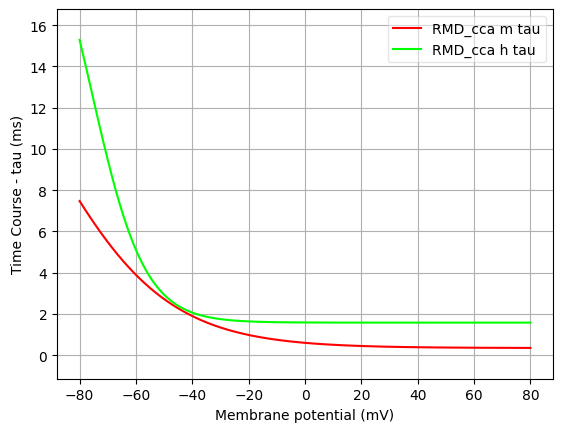
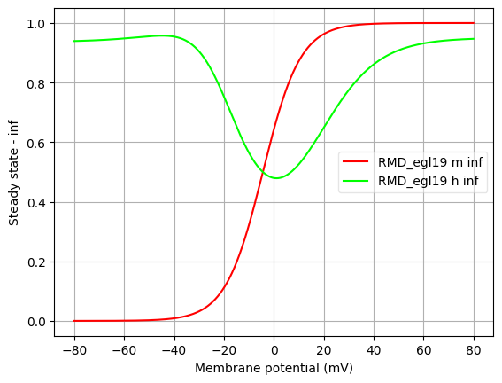
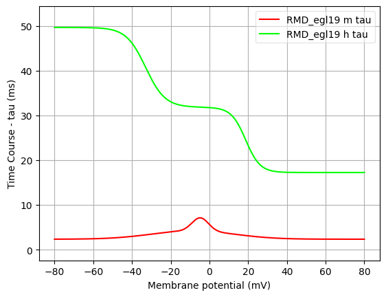
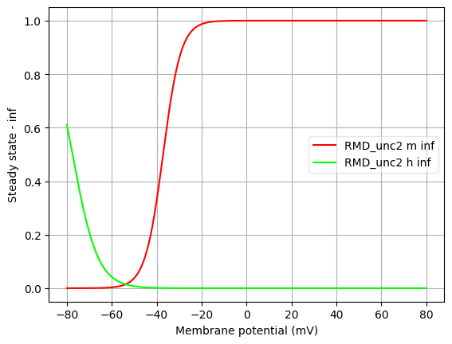
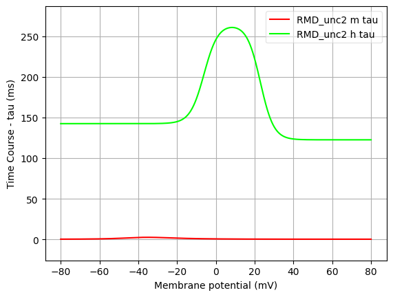

Channel information
===================

Channel information at: T = 6.3 degC, E_rev = -80.0 mV, [Ca2+] = 5e-05 mM

<h2>RMD_shak</h2>

Ion: <b>k</b> |
Conductance expression: <b>g = gmax * m * h </b> |
NeuroML2 file: <a href="../RMD_shak.channel.nml">RMD_shak.channel.nml</a>

Notes
RMD_shak channel from Nicoletti et al. 2019

<h2>RMD_kir</h2>

Ion: <b>k</b> |
Conductance expression: <b>g = gmax * m </b> |
NeuroML2 file: <a href="../RMD_kir.channel.nml">RMD_kir.channel.nml</a>

Notes
RMD_kir channel from Nicoletti et al. 2019

<h2>RMD_cca</h2>

Ion: <b>ca</b> |
Conductance expression: <b>g = gmax * m2 * h </b> |
NeuroML2 file: <a href="../RMD_cca.channel.nml">RMD_cca.channel.nml</a>

Notes
RMD_cca channel from Nicoletti et al. 2019

<h2>RMD_egl19</h2>

Ion: <b>ca</b> |
Conductance expression: <b>g = gmax * m * h </b> |
NeuroML2 file: <a href="../RMD_egl19.channel.nml">RMD_egl19.channel.nml</a>

Notes
RMD_egl19 channel from Nicoletti et al. 2019

<h2>RMD_unc2</h2>

Ion: <b>ca</b> |
Conductance expression: <b>g = gmax * m * h </b> |
NeuroML2 file: <a href="../RMD_unc2.channel.nml">RMD_unc2.channel.nml</a>

Notes
RMD_unc2 channel from Nicoletti et al. 2019

